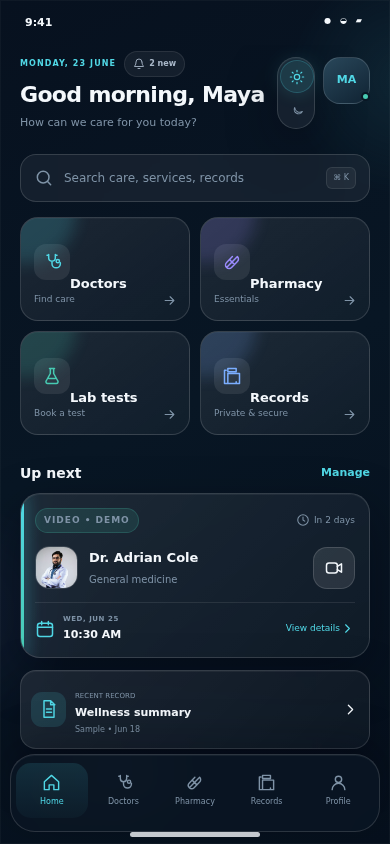
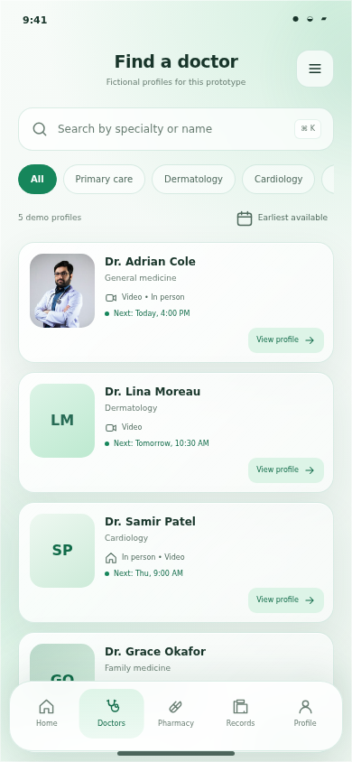
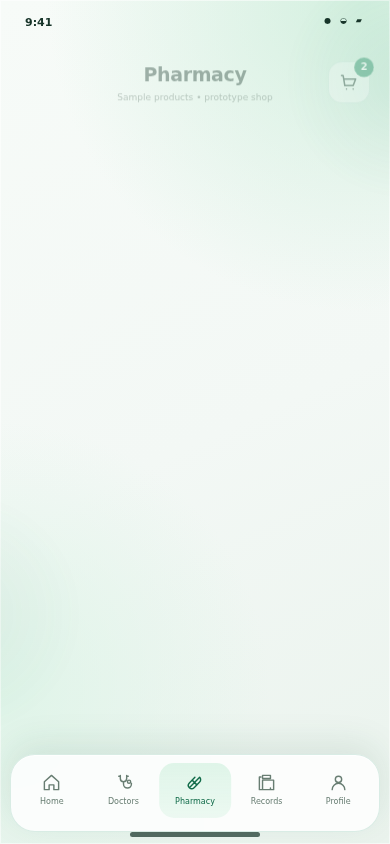
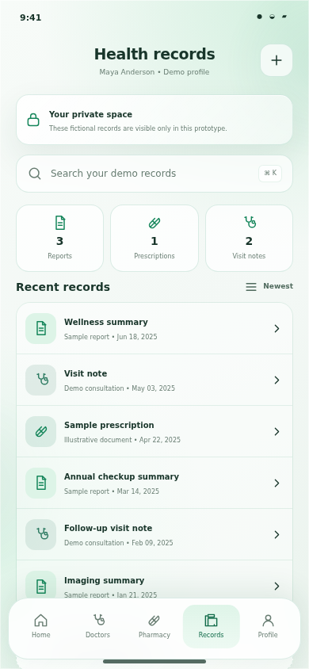

# Smart Healthcare Super App

A mobile-first React prototype of a unified healthcare app for patients and caregivers — doctor consultations, pharmacy, lab tests, health records and emergency information in one place.

**Live demo:** https://rr188351.github.io/Smart-Healthcare-Super-App/

<div align="center">
  
  
  
  
</div>

## Highlights

- **Complete patient journey** — splash, welcome, login and create account, home, doctor discovery and profiles, appointment booking with confirmation, video consultation, pharmacy, product details, cart, lab tests, lab booking, health records, report details, notifications, profile, settings, help and emergency guidance.
- **Light and dark themes** driven entirely by CSS custom properties, with an animated theme switch and a `prefers-reduced-motion` path.
- **On-device state** — session, cart, bookings, saved items and preferences persist in `localStorage`; no backend required.
- **Real iPhone 14 frame on desktop** — bezel, Dynamic Island, side buttons and a glass sheen. On phones the frame disappears and the app fills the screen.
- **Minimal dependencies** — React and React DOM only at runtime.

## Tech stack

| Area | Choice |
| --- | --- |
| UI | React 19 + TypeScript 5.7 |
| Build | Vite 8 |
| Styling | Tailwind CSS v4 utilities plus hand-authored design tokens in `src/index.css` |
| Formatting | oxfmt |

## Getting started

```bash
npm install
npm run dev      # dev server on http://localhost:8443
npm run build    # production build into dist/
npm run preview  # serve the production build
npm run format   # format with oxfmt
```

The project also ships a `pnpm-lock.yaml`, so `pnpm install` works too.

## Desktop preview frame

On viewports **701 px or wider** the app renders inside its own iPhone 14 mockup. The phone is a fixed `426 × 908` device that is scaled uniformly (`transform: scale(var(--ps))`) inside a footprint wrapper, so it keeps exact phone proportions at any window size instead of stretching. Height bands pick `--ps` so the phone always fits the window.

Everything lives in the "iPhone 14 device frame" block at the end of `src/index.css`:

- `.phone` — the body (padding `44px 17px 17px`, radius `54px`); the 44 px top bezel houses the Dynamic Island so it never covers the UI
- `.phone-screen` — the glass: fills the bezel at a true iPhone 14 size (392 × 847) and clips the app
- `.phone-island`, `.phone-button` — Dynamic Island and the volume/power buttons
- `@media (min-width: 701px) and (max-height: …)` — the `--ps` scale bands

Below 701 px the app is full-bleed mobile: the frame, the side buttons and the prototype label are hidden.

## Deployment (GitHub Pages)

`.github/workflows/deploy.yml` builds the app on every push to `main` and publishes it with GitHub Pages.

One-time setup in the repository: open **[Settings → Pages](https://github.com/rr188351/Smart-Healthcare-Super-App/settings/pages)** and set **Build and deployment → Source** to **GitHub Actions**. Until that is done, the workflow stops at its "Configure Pages" step, and GitHub's built-in *pages-build-deployment* (branch source) publishes the raw repository instead of the built app.

What the workflow does:

1. `npm ci`
2. `npm run build` with `GITHUB_PAGES=true`, which switches Vite's `base` to `/Smart-Healthcare-Super-App/`
3. copies `case-study/` into `dist/case-study/` so the UX portfolio is published too
4. uploads `dist/` and deploys it

Resulting URLs:

- App — `https://rr188351.github.io/Smart-Healthcare-Super-App/`
- UX case study — `https://rr188351.github.io/Smart-Healthcare-Super-App/case-study/`

To build the Pages variant locally, or to override the base path (for a custom domain or a `<user>.github.io` site):

```bash
GITHUB_PAGES=true npm run build          # /Smart-Healthcare-Super-App/
GITHUB_PAGES=true VITE_BASE_PATH=/ npm run build
```

## Project structure

```text
.
├── .github/workflows/deploy.yml   # GitHub Pages build + deploy
├── .figma/make/                   # Figma Make tooling (dev server, deploy, site config)
├── case-study/                    # standalone UX/UI portfolio site
├── public/                        # favicon and doctor portrait placeholder
├── src/
│   ├── App.tsx                    # screens, sheets, dialogs and the phone shell
│   ├── data.ts                    # doctors, products, lab tests, records, content
│   ├── index.css                  # design tokens, component styles, iPhone 14 frame
│   ├── store.tsx                  # app state, persistence and navigation
│   ├── ui.tsx                     # shared components (Glass, Button, Icon, …)
│   └── main.tsx
├── index.html
├── vite.config.ts
└── package.json
```

`.figma/make/site.json` holds the site metadata (title, description, robots). `index.html` keeps `figma:*` comment slots that the Vite plugin fills from that file at build time.

## UX case study

`case-study/` is a standalone static site (semantic HTML, CSS and JavaScript) documenting the design process, with a screenshot gallery. Open `case-study/index.html` directly, or serve the directory with any static file server — all asset URLs are relative. It is also published at `/case-study/` by the workflow above.

The screenshots in `case-study/assets/screenshots/` are stored as regular files — this repository deliberately does not use Git LFS, so keep new assets small.

## Accessibility

The app includes semantic landmarks, labelled controls, visible focus states, `prefers-reduced-motion` support, a large-text preference and an accessible theme switch.

## Verification

```bash
npm run build      # Vite production build
npx tsc --noEmit   # type check
```
